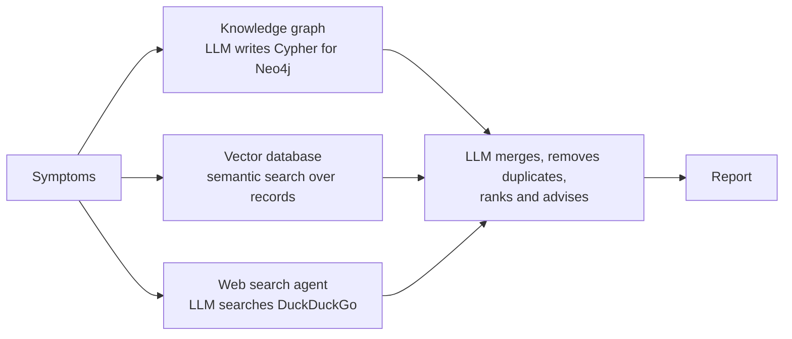
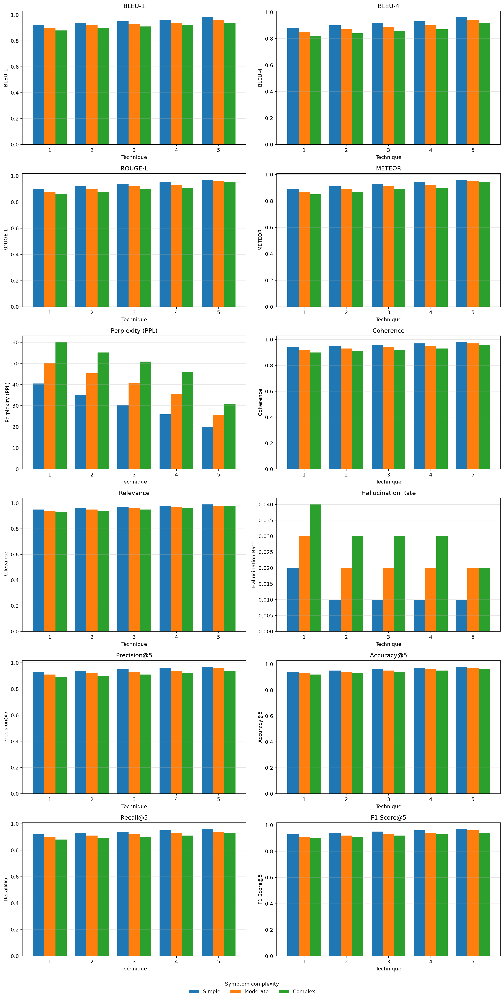
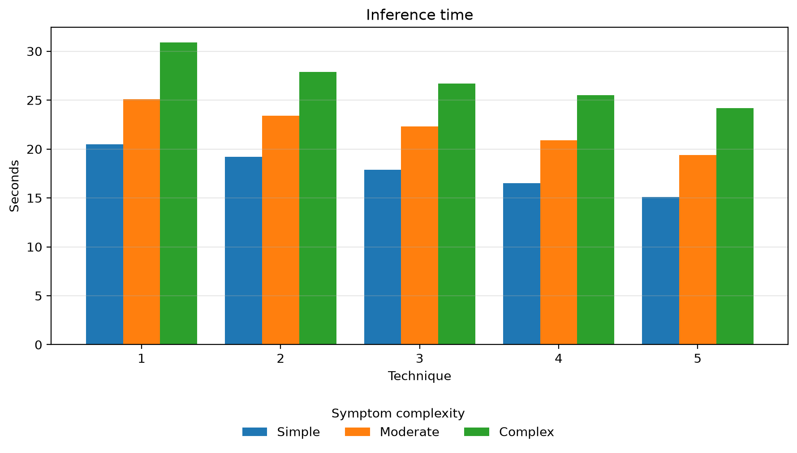
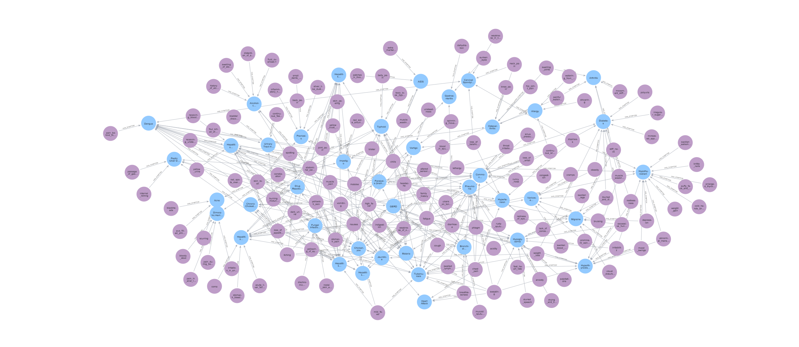

# Symptom-Based Disease Prediction

**An LLM assistant that turns a list of symptoms into likely diseases, diet advice and the right specialist to see. Its answer is grounded in a knowledge graph, a vector database and live web search.**

 

The project builds and compares three ways of giving an LLM reliable medical context (Retrieval-Augmented Generation, or RAG). Combining all three gave the best accuracy, the fewest hallucinations and the fastest responses.


## Example

```bash
symptom-dx predict "itching, skin rash, nodal skin eruptions"
```

Excerpt from a real report (web search source):

| Likelihood | Condition | Why it fits |
|---|---|---|
| High | Prurigo nodularis | Classic chronic, intensely itchy rash that evolves into firm, hyper-keratotic nodules. |
| High | Atopic dermatitis with lichenified nodules | Severe eczema produces a widespread itchy rash; chronic scratching creates thickened, nodular plaques. |
| High | Scabies (nodular scabies) | Intensely itchy rash; chronic infestation can lead to nodular lesions. |
| Medium | Cutaneous T-cell lymphoma | Early patches are itchy; later stages may develop nodules. |

The full report continues with diet advice, natural measures, which specialist to see, and a reminder that it is not a diagnosis.

## How it works



| Source | What it does | Built with |
|---|---|---|
| **Knowledge graph** | Stores 41 diseases and their symptoms in Neo4j. The LLM translates the question into a Cypher query and runs it. | Neo4j, LangChain |
| **Vector database** | Finds the dataset records whose symptoms are most similar to the input. | LlamaIndex, Ollama embeddings |
| **Web search agent** | The LLM decides what to search, reads the results and summarizes them. | LangChain agent, DuckDuckGo |

A final LLM step (Groq) cross-checks the answers, removes contradictions and duplicates, and writes one report. If a source is unavailable, the others still answer.

## Results

Five source combinations were evaluated on simple, moderate and complex symptom sets. The table shows the average over the three.

| # | Sources | Accuracy@5 | F1@5 | Hallucination rate | Response time |
|---|---|---|---|---|---|
| 1 | Vector database | 0.93 | 0.91 | 3.0% | 25.5 s |
| 2 | Knowledge graph | 0.94 | 0.92 | 2.0% | 23.5 s |
| 3 | Web + vector | 0.95 | 0.93 | 2.0% | 22.3 s |
| 4 | Web + knowledge graph | 0.96 | 0.94 | 2.0% | 21.0 s |
| **5** | **Web + knowledge graph + vector** | **0.97** | **0.96** | **1.7%** | **19.6 s** |

<details>
<summary>All metrics (BLEU, ROUGE-L, METEOR, perplexity, coherence, relevance and more)</summary>




The raw numbers are in [`results/`](results/).
</details>

<details>
<summary>The knowledge graph in Neo4j</summary>


</details>

## Tech stack

**LLM and RAG:** LangChain, LlamaIndex, Groq (`gpt-oss-120b`), Ollama (`nomic-embed-text`)
**Data:** Neo4j (graph), pandas
**Engineering:** Python package with a command-line tool, pytest, ruff, GitHub Actions CI

## Quick start

**1. Install** (Python 3.10+)

```bash
python -m venv .venv && source .venv/bin/activate
pip install -e ".[dev]"
```

**2. Add credentials** in a `.env` file in the project root (it's gitignored):

```ini
GROQ_API_KEY=your-groq-key
NEO4J_URI=neo4j+s://<instance-id>.databases.neo4j.io
NEO4J_USERNAME=neo4j
NEO4J_PASSWORD=your-password
```

You can get a free Groq key at [console.groq.com](https://console.groq.com) and a free Neo4j database at [Neo4j Aura](https://neo4j.com/cloud/aura-free/). The vector database also needs [Ollama](https://ollama.com) running locally, with `ollama pull nomic-embed-text`.

**3. Build the data stores, then predict**

```bash
symptom-dx preprocess     # clean the dataset
symptom-dx build-kg       # load it into Neo4j
symptom-dx build-index    # build the vector database

symptom-dx predict "high fever, chills, sweating"
symptom-dx predict "cough, breathlessness" --sources web    # use only some sources
```

Run `symptom-dx --help` to see all options.

## Project structure

```
src/symptom_dx/
  data.py             cleans the dataset and normalizes symptom names
  knowledge_graph.py  builds the Neo4j graph and queries it
  vector_store.py     builds and queries the vector database
  web_agent.py        web search agent
  pipeline.py         asks each source, then merges the answers
  prompts.py          all LLM prompts
  cli.py              the symptom-dx command
tests/                unit tests (run offline, no API keys needed)
data/                 raw and cleaned dataset
results/              evaluation results and charts
```

## Engineering highlights

- **Fault tolerant:** if one source fails (for example, the database is down), the report is built from the others.
- **Safe database writes:** data is sent to Neo4j as query parameters, never pasted into query text.
- **Consistent inputs:** "Skin Rash", "skin rash" and "skin_rash" all match the same symptom.
- **Tested:** unit tests use fake models, so they run in seconds without network or keys. CI runs lint and tests on every push.

```bash
pytest && ruff check src tests
```

## Dataset

[SymbiPredict 2022](data/raw/symbipredict_2022.csv): 4,961 patient records, 132 symptoms, 41 diseases.

## License

MIT. See [LICENSE](LICENSE).
